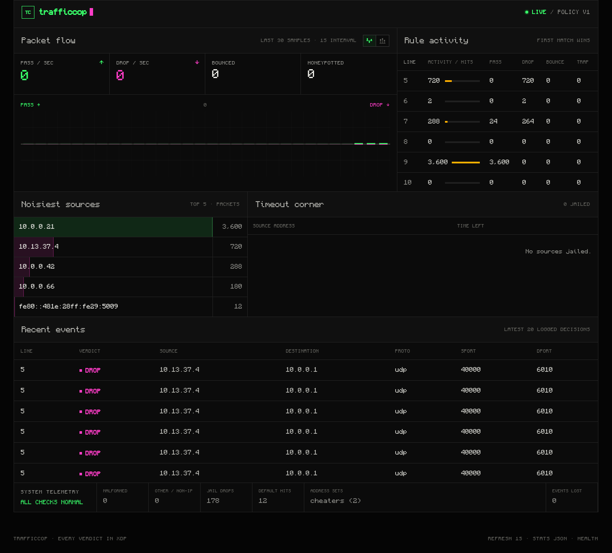

# BytecodeBouncer / trafficcop

Hackathon eBPF/XDP firewall for the Bytecode Bouncer problem. The kernel, complete
rules/CLI, atomic reload, telemetry and dashboard are integrated. Local checks
run on Ubuntu 24.04 / WSL Linux 6.18; **the judges' Linux 6.8 validation and final
flood benchmark remain open**. Deadline: 13 November 2026, 11:59 p.m. IST.

Read [problem statement](problem_Statement.md), [architecture](architecture.md),
[contributor instructions](AGENTS.md), and [implementation checklist](docs/spec-checklist.md).

## Build

On Ubuntu 24.04 with root/sudo and network access:

```sh
./build.sh --install-deps
```

The script installs clang, llvm, libbpf-dev, linux-libc-dev, gcc, make, golang-go,
iproute2, python3, ca-certificates and git, then compiles `./trafficcop`.
Go 1.22+ is required. Go dependencies are pinned in go.mod/go.sum. Subsequent
builds use `./build.sh`. The daemon needs root, BPF/network-admin capabilities,
and a kernel with native XDP/bpf_link support. No CGO or external object file is
needed at runtime. Native XDP is required; there is no silent generic-mode fallback.

The Go cilium/ebpf library loads the BPF object; libbpf is used only for its C
headers at build time. The target is x86-64 Ubuntu 24.04/Linux 6.8, four CPUs.

## Run safely

```sh
make test
make integration
make stress
make endurance  # separate five-minute reload/set/maximum-policy resource check
```

Integration/stress tests create private namespaces/veths and attempt cleanup on
every exit. They refuse an existing daemon. No tests replace a host attachment.
Do not deploy on a production interface without target-platform verification.

For a persistent demo, the setup script creates its own namespace and veth pair:

```sh
sudo ./demo.sh start
sudo ./demo.sh stats
sudo ./demo.sh dashboard
```

The last command runs a foreground localhost proxy. Open **http://127.0.0.1:8088/**
in your normal browser. Ctrl+C stops the proxy; the demo remains running.
The proxy uses Python's standard library and forwards only fixed dashboard
assets/JSON endpoints into the namespace. It fails if host port 8088 is busy.
The demo loads `tests/fixtures/demo.rules`. To generate illustrated traffic:

```sh
sudo nsenter --net=/run/netns/trafficcop-demo python3 tests/bench/demo_traffic.py
```

When finished:

```sh
sudo ./demo.sh stop
```

Stop removes the owned namespace and stops its trafficcop instance. If you left
the foreground dashboard proxy running in another terminal, stop it with Ctrl+C.
Repeated stop is harmless. Start refuses existing resources or another instance;
namespace/socket ownership is checked before cleanup. Failed startup rolls back
resources it created. Build and demo setup remain separate; `trafficcop start`
still operates on an existing interface as the grading harness requires.

## CLI and behavior

Inside your dedicated network namespace:

```sh
./trafficcop start eth0 arcade.rules hp0   # optional hp0 honeypot interface
./trafficcop reload arcade-next.rules
./trafficcop set add cheaters 2001:db8:bad::/48
./trafficcop set del cheaters 10.0.0.7/32
./trafficcop stats
./trafficcop jail
./trafficcop unjail 2001:db8::7
./trafficcop log
./trafficcop stop
```

Rules implement every specified action/condition, mixed-family prefixes/sets,
first-match ordering, VLAN/options/fragments and bounded IPv6 extension chains.
Rate limits have independent 65,536-source LRU maps per rule, shared across CPUs.
All packet decisions happen inside XDP; Go only manages configuration/state and
observability. Each reload constructs an immutable private program/config and
atomically updates the existing XDP link. Persistent counters, jail/cancellation
records and log history survive; sets and per-rule counters are replaced.
Immutable per-generation feature masks prune unused verifier paths without
relaxing the one-second reload deadline or disabling configured rules.

CLI `stats` and `/stats.json` use the same snapshot implementation. `/jail.json`
and `/log.json` expose those same command snapshots; `/health.json` separately
reports allocation/ring/stream failures without altering the required stats
schema. A dedicated goroutine drains events and retains exactly the newest
1,000 oldest-first; logged decisions are never synthesized in userspace.
A temporary log snapshot timeout is recoverable: later requests wait for the
outstanding flush barrier before issuing a new one. Terminal stream errors stay
visible through diagnostics. Runtime policy files must be regular files or
`/dev/null`, at most 16 MiB including comments; FIFOs/devices are rejected before
opening for reads. The grammar reader remains available for in-memory tests.
Finite state limits and target-platform gaps are documented in
[integration validation](docs/integration-validation.md).

## Dashboard

Maintainer follow-up results and remaining target-hardware requirements:
[remaining-work validation](docs/remaining-work-validation.md).

Embedded HTML/CSS/JavaScript updates every second, including passed/dropped pps,
rule hits, source ranking, jail, latest events, malformed/other and diagnostics.
No frontend dependencies. Actual isolated-demo screenshot (traffic idle at capture,
so pps is zero; totals come from real XDP decisions on synthetic frames):



### Person A dataplane tests and handoff

```sh
bash bpf/test.sh                # exact short parser fixtures, ASan/UBSan
sudo bash bpf/test.sh --kernel  # actual BPF packet/state/ABI/four-CPU tests
sudo bash bpf/netns-test.sh     # private veth wire actions/replacement under load
```

The XDP implementation supports all rule conditions and actions, mixed-family
sets, independent limit maps with at least 65,536 usable source entries each, jail/scans and logged decisions.
See [ABI and B/C handoff](docs/dataplane-abi.md) and
[actual validation/limitations](docs/dataplane-validation.md). The ABI includes
explicit diagnostic counters for finite map capacity and event-ring failures.

The daemon reports readiness through a pipe, owns an exclusive lock and private
Unix socket under `/run/trafficcop`, and embeds its web assets. No BPF maps are
pinned. Stop releases the XDP link, map/program descriptors, control socket and
HTTP port; SIGTERM/SIGINT also clean up. SIGKILL/crash recovery beyond automatic
FD closure is not yet a tested lifecycle guarantee. Startup diagnostics append
to `/run/trafficcop-bootstrap.log`. The lock file remains as a harmless reusable
inode; do not delete it while a daemon is running.

## Contribute and raise a PR

Use the three implementation issues for ownership and acceptance criteria:

- [Person A: XDP dataplane](https://github.com/TANKominator5/BytecodeBouncer/issues/1)
- [Person B: control plane and reload](https://github.com/TANKominator5/BytecodeBouncer/issues/2)
- [Person C: observability and test bench](https://github.com/TANKominator5/BytecodeBouncer/issues/3)

```sh
git fetch origin
git switch -c feat/<area> origin/main
# implement and test your issue
./build.sh
make test
sudo tests/integration/bootstrap.sh
git add <your-files>
git commit -m "Describe the problem and resulting behavior"
git push -u origin feat/<area>
gh pr create --base main --head feat/<area> --title "Concrete behavior" --body-file /tmp/pr.md
```

In `/tmp/pr.md`, explain behavior, list checks actually run, disclose missing
checks/limitations, call out shared ABI changes, and include `Closes #<issue>`.
Ask the other two people to review. Keep shared-ABI changes small and agreed in
advance. Merge green, reviewed PRs frequently; update your branch from main
before integrating. Each person uses a separate clone/worktree and branch.

## Validation evidence

See [integration validation](docs/integration-validation.md),
[kernel validation](docs/dataplane-validation.md) and historical
[bootstrap validation](docs/bootstrap-validation.md). Measured daemon logging:
90,000 decisions in 3.601 s (~24,997/s), zero loss, exact last-1,000 history under
concurrent/slow HTTP clients. These are local measurements, not a flood/NIC
throughput ranking or a Linux 6.8 guarantee. CI is configured for the expanded
smoke suite on Ubuntu 24.04; inspect its result after publishing rather than
assuming it passed.
